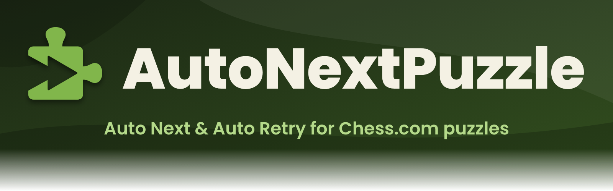
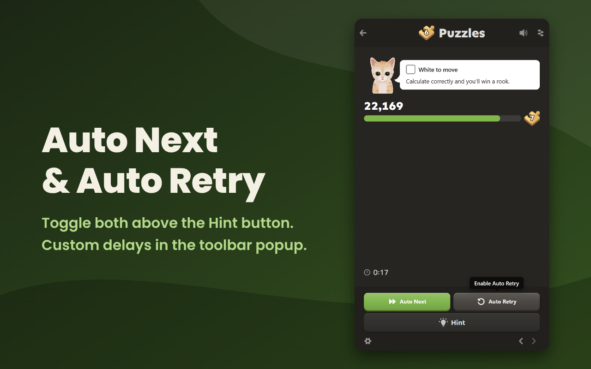
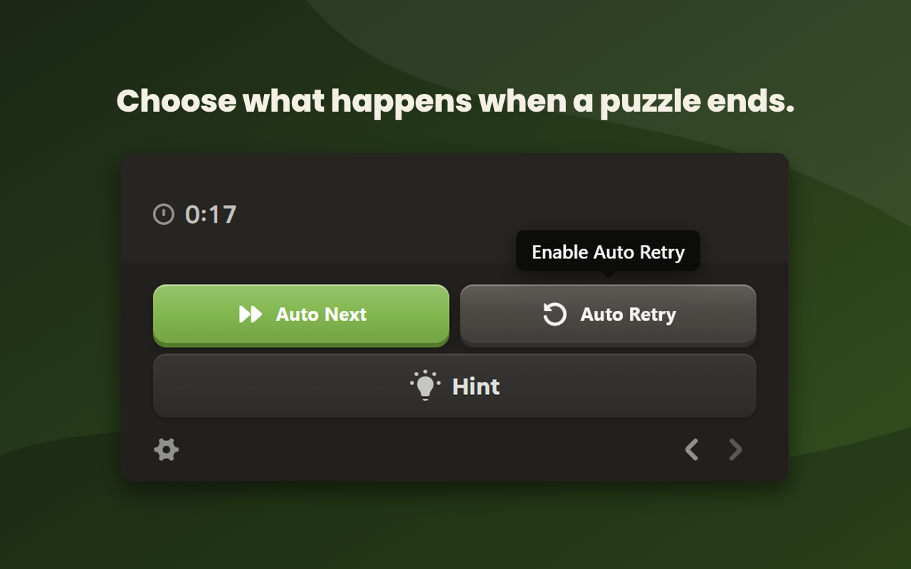

 

  

  
  

## What does this do?

AutoNextPuzzle advances to the next Chess.com puzzle after you solve it, or retries the puzzle if you miss a move.

You can toggle **Auto Next** and **Auto Retry** right above the Hint button on Chess.com, or click the extension icon to set custom delays (50 ms for Next and 150 ms for Retry by default).

  
  

## Modes

| Auto Next | Auto Retry | What it does |
|---|---|---|
| On | On | Advances after a solve and retries after a miss |
| On | Off | Advances to the next puzzle after both solves and misses |
| Off | On | Retries missed puzzles and waits on solves |
| Off | Off | Does nothing automatically |

## Install

- **Firefox:** [Firefox Add-ons](https://addons.mozilla.org/firefox/addon/auto-next-puzzle/) (or install manually using the [Mozilla branch](https://github.com/bewf/AutoNextPuzzle/tree/mozilla) via `about:debugging#/runtime/this-firefox`).
- **Chrome / Brave:** [Chrome Web Store](https://chromewebstore.google.com/detail/kkjonhiflkkmdngelljdijddhcnnnelf) (or install manually using the [Chromium branch](https://github.com/bewf/AutoNextPuzzle/tree/chromium) via `chrome://extensions` or `brave://extensions`).

## Credits

Originally based on [AutoNextPuzzle v1.1](https://github.com/fwhuy/AutoNextPuzzle) by Huy ([MIT License](LICENSE)).
